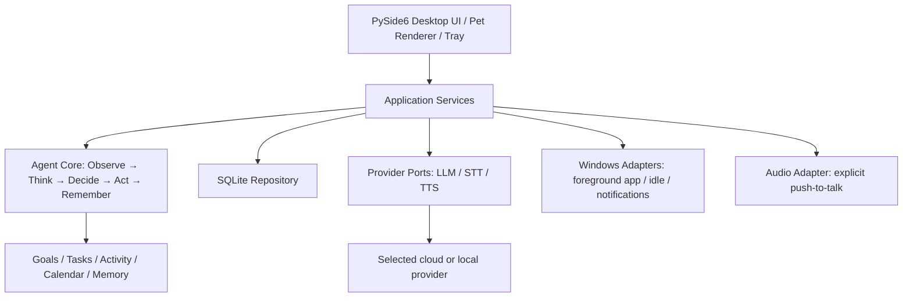

# AI Companion：架构决策

日期：2026-09-24

## 产品目标与首版边界

目标是做一个本地优先、长期了解学习目标的 Windows 个人 Companion。Agent Core 接收当前应用、空闲时长、当天任务与记忆，先用可解释的本地策略决定何时提醒；LLM 负责对话和协商措辞，不能越过用户设定的时间边界。桌宠、聊天窗、托盘和语音都是独立适配层，不能承载计划或决策规则。

首版聚焦可实际验证的闭环：桌宠与聊天窗（含拖动和托盘控制的鼠标穿透开关）、SQLite 任务和记忆、前台应用时长、规则型决策、主动提醒和延期计时、文字对话、按键后录音的语音输入与 TTS。日历规则先建好数据模型，课程导入界面可以后置。默认不截图、不记录标题栏文字、键盘内容或聊天内容来推断活动；监测与麦克风都有显式开关。开机启动必须是可配置且默认关闭的设置。

## 技术路线

| 维度 | Tauri 2 + Rust + React/TypeScript | Python 3.10+ + PySide6 |
|---|---|---|
| 运行性能 | Rust 后端，前端使用系统 WebView2；发行包通常更小，内存表现取决于 WebView 与动画负载 | Qt 的 C++ 渲染由 Python 驱动，桌宠动画足够流畅；需分发 Python/Qt 运行时，发行包通常更大 |
| Windows API | 需要 Rust 命令或插件封装 Win32；需理解 IPC 与能力权限 | 可用 Qt 窗口标志和 Python `ctypes`/Win32 封装直接访问 API |
| 透明桌宠 | 官方支持透明窗口和置顶；鼠标穿透、焦点和拖动仍需在 Windows 实测 | Qt 提供无边框、置顶、输入穿透标志；可通过同一套窗口适配层控制 |
| 动画与 UI | React/CSS/Canvas 很适合精细角色与聊天 UI | Qt Widgets/QML 都可用，角色状态与渲染器可以分层 |
| 音频与 AI 生态 | Web Audio 与 Rust 音频生态可用，但跨层实时打断要设计 IPC | Python 的 AI/STT/TTS 集成快；Qt Multimedia 提供音频设备、录音和播放 API |
| 维护与类型 | Rust 对后端边界约束强，TypeScript 覆盖 UI；前后端需要维护接口 | 类型约束较弱，但 mypy/pyright、协议类与纯 Python 域模型足以支撑小团队 |
| 打包 | 借助系统 WebView2，包较小；Windows 开发需 Rust、MSVC C++ Build Tools | PySide6/Nuitka 可生成 Windows exe；需分发 Python/Qt 运行时，发布体积更大 |
| 开发速度 | 工程边界清晰，但当前工作环境没有 Rust/Cargo，初始环境成本高 | 当前已有 Python 3.10 与 Node；AI、SQLite 和 Agent 逻辑可以直接共用 Python |

**决策：首版采用 Python 3.10+、PySide6、标准库 SQLite。** PySide6 是 Qt 官方 Python 绑定，选择它而不是 PyQt6 是为了避免 PyQt 仅 GPLv3/商业双许可的额外限制；PySide6/Qt 仍需按所用模块遵守 LGPLv3/GPLv3 或商业许可要求。第一版将业务层写成无 Qt 依赖的纯 Python 包，未来如果需要 Web、移动端或机器人，只替换 UI/宿主适配，不重写 Goal、Memory 和 Decision API。对长期维护，固定依赖版本、静态类型检查、分层接口和 SQLite schema migration 是必要约束。

Tauri 的透明与置顶能力已经有官方 API，且系统 WebView2 有利于降低发行体积；但 Rust 与 C++ 构建依赖未在当前环境就绪。其优势暂不足以抵消首版需要快速迭代 Windows 活动感知、语音和多 provider 的成本。等 Agent API 稳定后，可以另做 Tauri UI spike，而不把它混进首版。

## 开源桌宠项目评估

| 项目 | 许可证与维护信号 | 架构/Windows 适配 | 决策 |
|---|---|---|---|
| [VPet-Simulator](https://github.com/LorisYounger/VPet) | 仓库代码使用 Apache-2.0；默认动画由 VUP-Simulator 团队持有并有独立使用条款。2026-08-18 仍有代码提交。 | WPF 项目将 Windows UI、可嵌入 Core、Graph/动画和 Display 分开，结构最值得参考；但主体是宠物模拟器与 MOD 生态。 | 不 fork。只借鉴“核心与渲染/显示分离”的边界，不复制源码和动画素材。 |
| [Desktop-Pets](https://github.com/LGaben/Desktop-Pets) | README 标注 MIT；仓库页面显示仅 2 次提交。素材来自 VS Code Pets，需单独核对原素材许可。 | PyQt5、透明置顶、托盘和动画与桌宠壳相近，但项目体量和提交历史不足以承担长期 Agent 核心。 | 不 fork，也不复制素材。 |
| [QtDesktopPet](https://github.com/Ysm-04/DesktopPet) | README 标注 MIT；页面显示 1 次提交（2026-06-16 发布）。项目也说明角色图、图标和音效可能有独立权利。 | Qt 6/C++，支持透明窗口、角色包和 AI 对话，功能表面接近；单次发布不足以判断维护质量，现有功能与本产品的 Agent/计划边界不同。 | 不 fork；仅作为 Windows 桌宠功能清单参考。 |

因此从空仓库自建核心框架。角色图先用项目自有的简单矢量绘制，后续导入角色包时要求每个资源携带来源、许可证和作者信息。

## 分层架构



`companion.domain` 不导入 PySide6、Windows API、数据库连接或厂商 SDK。`companion.application` 编排用例并通过 Protocol 接口访问存储、活动、语音和模型。Windows/Desktop adapters 只负责系统数据获取与呈现。LLM 的云端调用只发送用户输入和明确配置的上下文；活动记录默认留在 SQLite。

```text
src/companion/
  domain/        entities.py, decisions.py, calendar.py, memory.py
  application/   agent_loop.py, task_service.py, chat_service.py
  ports/         llm.py, voice.py, activity.py, repositories.py
  adapters/
    windows/     foreground.py, idle.py, notifications.py, secrets.py
    voice/       push_to_talk.py, stt_provider.py, tts_provider.py
    providers/   openai_compatible.py, local_model.py
  infrastructure/sqlite/ migrations.py, repositories.py
  desktop/      app.py, pet_window.py, chat_window.py, tray.py
tests/
```

首阶段目录会按实际代码命名逐步建立，不预先创建空模块。

## 核心数据模型

| 表/实体 | 关键字段 | 用途 |
|---|---|---|
| `goals` | `id`, `name`, `target`, `priority`, `active` | 职业发展、课程学习、个人项目等长期目标 |
| `tasks` | `id`, `goal_id`, `title`, `due_date`, `planned_minutes`, `completed_units`, `target_units`, `priority`, `hard_start`, `hard_end`, `status` | 每日任务、数量目标、优先级和可选的硬时间段 |
| `activity_sessions` | `id`, `app_name`, `category`, `started_at`, `ended_at`, `duration_seconds`, `idle_seconds` | 只保留应用名、分类和时长；不保存窗口标题、输入或屏幕内容 |
| `memories` | `id`, `kind`, `content`, `source`, `importance`, `created_at`, `expires_at` | `profile`, `preference`, `behavioral`, `episodic`, `conversation` 五类记忆；检索摘要而非拼接全部历史 |
| `conversations` / `messages` | 会话 id、角色、内容、时间、是否已摘要 | 对话上下文分段；保留与清除由用户控制 |
| `reminders` | `id`, `reason`, `created_at`, `cooldown_until`, `extension_deadline`, `status` | 幂等提醒、短期延期和再次提醒 |
| `academic_terms` | `id`, `start_date`, `week_one_start`, `total_weeks` | 从日期推导教学周 |
| `course_rules` | `term_id`, `weekday`, `start_week`, `end_week`, `week_parity`, `start_time`, `end_time`, `course_name` | 周次区间、单双周、星期与时间 |
| `calendar_exceptions` | `date`, `kind`, `replacement_weekday`, `note` | 放假、调休、补课；按日期覆盖周期规则 |
| `settings` | `key`, `value`, `updated_at` | 监测/麦克风开关、提醒阈值、人格档案、模型配置（不含 secret） |

SQLite 连接启用外键、迁移版本和事务。API Key 放在 Windows Credential Manager 适配器里，绝不进数据库、日志、崩溃报告或 prompt。关闭监测时立即结束采样；删除记忆和清除对话分别提供明确操作。

## Agent Decision Loop

每 30 秒至一分钟由本地 scheduler 发起一次 tick；不使用 LLM 决定是否打断。

1. **Observe**：读取前台进程名、活动连续时长、idle time、当天未完成任务、硬截止、最近提醒和用户开关。Windows 使用 `GetForegroundWindow` → `GetWindowThreadProcessId` 获取前台进程，`GetLastInputInfo` 估算当前登录会话的 idle time。
2. **Think**：基于任务优先级、剩余目标、计划额度、历史延期行为，生成结构化 `InterventionContext` 和原因码。最多取回有限条相关记忆。
3. **Decide**：可解释规则评估 `interrupt / wait / stay_silent`。当活动不足阈值、用户空闲、已经提醒过、提醒关闭、无紧迫未完成任务时保持沉默。P0/硬截止优先，P1 可协商，P2 只建议。
4. **Act**：以统一 `ReminderEvent` 发到 UI；允许 TTS provider 播报，但可被用户静音/打断。用户提出延期时，Decision Service 检查剩余计划与 `hard_end`，记录一次性 `extension_deadline`，不覆盖原始硬截止。
5. **Remember**：仅写入决策原因、接受/拒绝/延期结果、任务完成和简短事件摘要；不把整个 prompt 或系统活动明细当记忆。

验收策略样例：专注应用使用 30 分钟不提醒；连续使用 120 分钟且高优先级学习任务未完成时提醒；当天优先任务完成则允许继续个人项目；接受 20 分钟延期后保存 deadline，并在到期时再次提醒。默认空闲阈值为 300 秒、活动采样周期为 5 秒，两项都可在设置中调整。通知冷却与用户的“今天别提醒我”覆盖规则。

## 技术风险与控制

| 风险 | 控制措施 |
|---|---|
| 频繁打断破坏专注 | 本地规则、多因素门槛、冷却期、静默时段；决策写原因码，先验证示例后再调整阈值 |
| 前台窗口/多进程映射不稳定 | 按进程 exe 名聚合；忽略自身、锁屏、桌面 shell 和 idle；允许手动分类；不读标题栏 |
| 计划数据错误导致越权延期 | 原硬截止不可被协商修改；extension 独立存储并带到期时间；用户始终能关提醒或覆盖计划 |
| 语音误录或泄露 | 默认 push-to-talk；录音状态常显；停止按钮可打断 STT/TTS；只在用户发出后传给所选 provider |
| AI 服务/API Key 风险 | 本地优先、Credential Manager、日志脱敏、provider allowlist/settings 显示云端发送范围 |
| 教学周/调休判断错误 | 先检查日期级 exception，再套 term/week/parity 规则；规则计算做纯函数测试并展示当日课程来源 |
| 透明窗口和缩放/多显示器差异 | 使用 Qt 窗口 flag；支持动态输入穿透；以 Windows 10/11 多 DPI、多屏手工验收 |
| PySide6 发行体积与许可 | 开发期先运行源码；发行时用 `pyside6-deploy`/Nuitka；建立第三方许可清单并检查 LGPL 要求 |

## 评估来源

- [Tauri 2 Windows prerequisites](https://v2.tauri.app/start/prerequisites/) 与 [window API](https://v2.tauri.app/reference/javascript/api/namespacewindow/)
- [Tauri system WebView model](https://v2.tauri.app/start/) 与 [WebView2 notes](https://v2.tauri.app/reference/webview-versions/)
- [Qt for Python overview and license](https://doc.qt.io/qtforpython-6/)
- [Qt window flags](https://doc.qt.io/qtforpython-6/PySide6/QtCore/Qt.html)；[Qt Multimedia](https://doc.qt.io/qtforpython-6/PySide6/QtMultimedia/index.html)；[PySide6 deploy](https://doc.qt.io/qtforpython-6/deployment/deployment-pyside6-deploy.html)
- [PyQt licensing](https://www.riverbankcomputing.com/software/pyqt) 和 [license FAQ](https://riverbankcomputing.com/commercial/license-faq)
- [VPet architecture and animation terms](https://github.com/LorisYounger/VPet/blob/main/README_en.md)；[VPet commit history](https://github.com/LorisYounger/VPet/commits/main/)
- [Desktop-Pets](https://github.com/LGaben/Desktop-Pets)；[QtDesktopPet](https://github.com/Ysm-04/DesktopPet)
- Microsoft Learn: [GetForegroundWindow](https://learn.microsoft.com/en-us/windows/win32/api/winuser/nf-winuser-getforegroundwindow), [GetWindowThreadProcessId](https://learn.microsoft.com/zh-cn/windows/win32/api/winuser/nf-winuser-getwindowthreadprocessid), [GetLastInputInfo](https://learn.microsoft.com/en-us/windows/win32/api/winuser/nf-winuser-getlastinputinfo)
